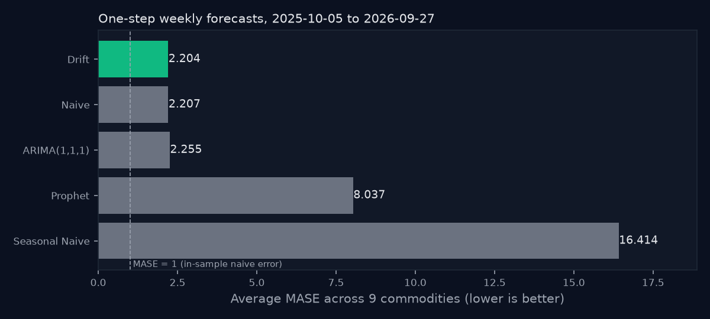
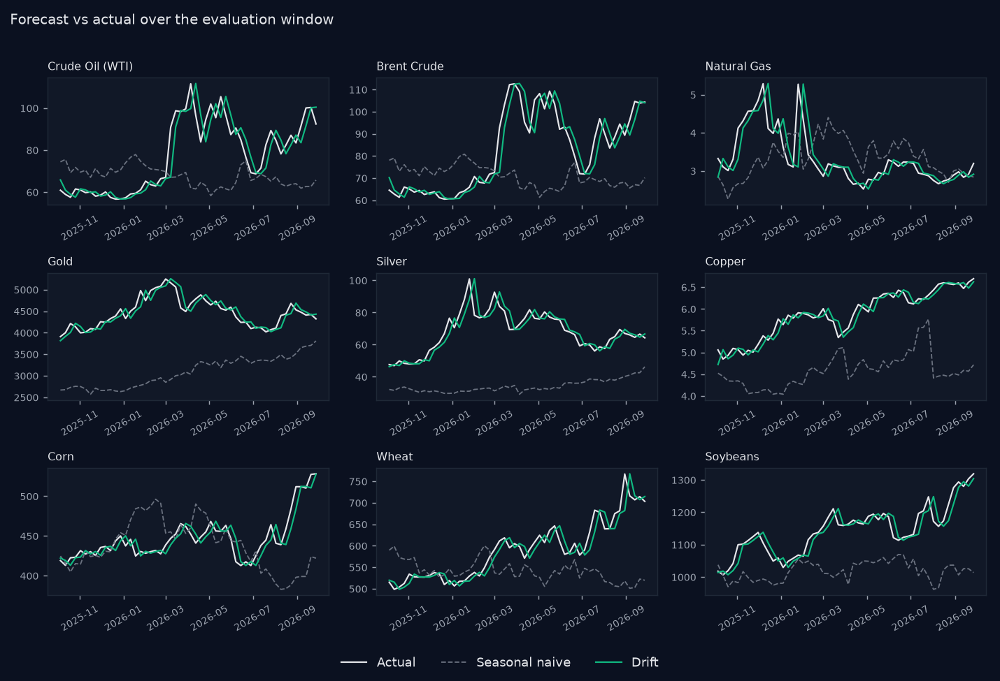

# Commodity price forecaster

Weekly forecasts for energy, metals, and grain futures. Prices are Yahoo Finance daily closes. The comparison is last-value, drift, and seasonal naive against ARIMA(1, 1, 1) and Prophet, scored one step ahead on a rolling origin. The Streamlit app also fits an LSTM and can show weather, a decomposition, and a simple risk table.

[Live demo](https://parbproject.github.io/commodity-price-forecaster/) reads `results/leaderboard.json`. The `gh-pages` branch is built from `site/` plus that file.

[](https://github.com/ParBproject/commodity-price-forecaster/actions/workflows/python-package-conda.yml)

## Results

<!-- results:start (generated by scripts/run_leaderboard.py) -->

**Evaluation window:** 52 weekly one-step forecasts from 2025-10-05 to 2026-09-27 (training history from 2016-01-10), across 9 futures. Data: Yahoo Finance via yfinance daily closes, snapshot `data/commodity_prices_daily_2026-09-30.csv` taken 2026-09-30.

**Winner: Drift**, average MASE 2.204 versus 16.414 for seasonal naive, 14.209 lower (86.57% better). A simple baseline won. Its lead over Naive is 0.0029 MASE, so the two baselines are effectively tied, and ARIMA(1,1,1) and Prophet did not beat it on average at a one-week horizon.

| Rank | Model | Avg MASE | Avg sMAPE (%) | Avg MAE |
|---:|---|---:|---:|---:|
| 1 | **Drift** | 2.204 | 4.00 | 20.21 |
| 2 | Naive | 2.207 | 4.01 | 20.30 |
| 3 | ARIMA(1,1,1) | 2.255 | 4.05 | 20.80 |
| 4 | Prophet | 8.037 | 14.58 | 86.05 |
| 5 | Seasonal Naive | 16.414 | 25.38 | 187.87 |

MASE by commodity (lower is better, best in **bold**):

| Commodity | Drift | Naive | ARIMA(1,1,1) | Prophet | Seasonal naive |
|---|---:|---:|---:|---:|---:|
| Crude Oil (WTI) (`CL=F`) | 2.035 | 2.036 | **2.033** | 5.873 | 7.863 |
| Brent Crude (`BZ=F`) | **1.960** | 1.961 | 1.976 | 6.292 | 8.335 |
| Natural Gas (`NG=F`) | 1.335 | **1.334** | 1.336 | 3.285 | 3.422 |
| Gold (`GC=F`) | **4.219** | 4.240 | 4.366 | 16.527 | 48.443 |
| Silver (`SI=F`) | 6.356 | **6.347** | 6.635 | 22.971 | 52.766 |
| Copper (`HG=F`) | 1.436 | 1.442 | **1.417** | 4.801 | 15.138 |
| Corn (`ZC=F`) | 0.741 | 0.743 | **0.738** | 2.770 | 2.705 |
| Wheat (`ZW=F`) | 0.897 | 0.898 | **0.891** | 3.280 | 3.886 |
| Soybeans (`ZS=F`) | **0.857** | 0.863 | 0.903 | 6.532 | 5.164 |





MASE is scaled by the in-sample mean absolute weekly change before the first origin. Values above 1 mean the evaluation year moved more than the training history did (gold and silver especially), not that the models broke. Seasonal naive repeats the price from 52 weeks earlier, which is a poor guide for trending futures prices.

Reproduce: `python scripts/run_leaderboard.py` (about a minute; Prophet is included when installed). The numbers are pinned by `tests/test_leaderboard.py::test_committed_leaderboard_headline_numbers` and recomputed from the snapshot by `tests/test_leaderboard.py::test_baselines_and_arima_recompute_from_snapshot`.

<!-- results:end -->

### Do the intervals cover?

Same 52 origins, scored on the ARIMA(1, 1, 1) prediction intervals rather than the point forecast. A calibrated 95% interval should contain the close about 95% of the time. The p-value is an exact two-sided binomial test of that rate. `scripts/run_calibration.py` writes `results/calibration.json`.

<!-- calibration:start (generated by scripts/run_calibration.py) -->
| Commodity | 80% coverage | 95% coverage | 95% misses (below / above) | 95% binomial p |
|---|---:|---:|---:|---:|
| Crude Oil (WTI) (`CL=F`) | 59.6% (31/52) | 71.2% (37/52) | 7 / 8 | 0.000 |
| Brent Crude (`BZ=F`) | 51.9% (27/52) | 75.0% (39/52) | 4 / 9 | 0.000 |
| Natural Gas (`NG=F`) | 82.7% (43/52) | 88.5% (46/52) | 4 / 2 | 0.045 |
| Gold (`GC=F`) | 25.0% (13/52) | 44.2% (23/52) | 12 / 17 | 0.000 |
| Silver (`SI=F`) | 40.4% (21/52) | 51.9% (27/52) | 9 / 16 | 0.000 |
| Copper (`HG=F`) | 69.2% (36/52) | 90.4% (47/52) | 1 / 4 | 0.187 |
| Corn (`ZC=F`) | 94.2% (49/52) | 100.0% (52/52) | 0 / 0 | 0.114 |
| Wheat (`ZW=F`) | 96.2% (50/52) | 98.1% (51/52) | 0 / 1 | 0.521 |
| Soybeans (`ZS=F`) | 84.6% (44/52) | 96.2% (50/52) | 2 / 0 | 1.000 |
| **Pooled** | **67.1%** (314/468) | **79.5%** (372/468) | | 0.000 |
<!-- calibration:end -->

On this window the intervals are too narrow for energy and precious metals (gold's nominal 95% interval held the price 44.2% of the time) and about right for the grains. The model estimates its error variance from the whole history back to 2016. When the price level and volatility rise, as gold and silver did in 2025–26, the band does not widen enough. Treat the bands as what the model implies, not as calibrated risk ranges.

### USDA yields as a regressor

Grains only. The extra feature is the log ratio of the latest USDA NASS national yield (monthly August–November Crop Production forecasts, then the January final) to the previous crop year's final yield. Release dates are taken as the 12th of the month, and the final as 12 January of the next year, so a report is not used before that date. Week t is forecast with the value known at week t−1. `scripts/run_usda_variant.py` writes `results/usda_variant.json`.

<!-- usda:start (generated by scripts/run_usda_variant.py) -->

Same 52 weekly one-step origins as the leaderboard, grains only. USDA data: NASS Quick Stats national yield forecasts and finals, snapshot `data/usda_cache.json` pulled 2026-10-23.

| Commodity | ARIMA(1,1,1) MASE | ARIMA(1,1,1)+USDA yield MASE | Change |
|---|---:|---:|---:|
| Corn (`ZC=F`) | 0.738 | 0.739 | +0.000 |
| Wheat (`ZW=F`) | 0.891 | 0.883 | -0.008 |
| Soybeans (`ZS=F`) | 0.903 | 0.903 | -0.001 |
| **Average** | **0.844** | **0.841** | **-0.003** |

<!-- usda:end -->

The yield feature barely moves one-week errors. Wheat improves a little; the average does not beat drift on these three grains (drift averages 0.832). Most of the report is already in the price by the weekly close. The variant stays out of the main leaderboard.

A NASS key is only needed to refresh the cache. Register at <https://quickstats.nass.usda.gov/api/> and store it as the Actions secret `USDA_NASS_API_KEY`. The `refresh-usda` workflow downloads `data/usda_cache.json` as an artifact, which is then committed. Locally: `USDA_NASS_API_KEY=... python scripts/refresh_usda.py`. The app, tests, and benchmark read the committed file and do not call the API.

## Dashboard

`app.py` has eight tabs. Default dates are 2020-01-01 through 2024-12-31.

- **Market overview.** Price, total return, annualised volatility of weekly returns, and the high and low of the last 52 weeks (the full sample if the history is shorter).
- **Forecast.** Auto-ARIMA when `pmdarima` is installed, otherwise ARIMA(1, 1, 1). Prophet, the average of those two paths, or an LSTM. The errors next to the chart are one multi-step forecast from 85% of the sample. The plotted path is a refit on the whole sample and does not change that score. Supply, demand, and weather sliders scale the plotted path only.
- **Forecast validation.** One-step last-value, drift, and seasonal naive at every remaining week. This is not the nine-commodity leaderboard above.
- **Weather.** Open-Meteo history for a chosen region, joined to weekly returns on the same dates. If the API is down, the tab draws a seeded simulated series and labels it as simulated. That series is not a model input.
- **Decomposition.** STL, with Hyndman seasonal and trend strength.
- **Risk.** Volatility, drawdown, and trend scores from the last 52 weeks. They are the same for every producer of that commodity. The geopolitical column is a fixed prior (a hash of the name plus a commodity base), not an estimated country risk.
- **Backtest.** Walk-forward ARIMA(1, 1, 1) with a chosen horizon and step.
- **Correlations.** Weekly returns for extra commodities selected in the sidebar.

Screenshots in `assets/screenshots/` are that default WTI view. The files named `01_` through `07_` predate the Backtest and Correlations tabs; the later shots include them. They show the interface, not a second published score.

Softs (coffee `KC=F`, cocoa `CC=F`, sugar `SB=F`, cotton `CT=F`) are in the dashboard only. The frozen leaderboard is the nine commodities in the snapshot.

## Companion

[Energy Sector Deep Dive](https://github.com/ParBproject/energy-sector-deep-dive) ([explorer](https://parbproject.github.io/energy-sector-deep-dive/)) uses the same WTI, Brent, and Henry Hub series. Its oil-scenario view can take this repo's latest one-step WTI forecast as a dated input. That copy is pinned to a commit and labelled as already realised.

## Run

```bash
git clone https://github.com/ParBproject/commodity-price-forecaster.git
cd commodity-price-forecaster
python -m venv .venv
source .venv/bin/activate
python -m pip install -r requirements.txt -r requirements-dev.txt
streamlit run app.py
```

```bash
python -m pytest -q
```

Regenerate the committed results from the price snapshot:

```bash
python scripts/run_leaderboard.py
python scripts/run_calibration.py
python scripts/run_usda_variant.py
```

Prophet is included in the leaderboard when it is installed. The first script takes about a minute.

## Layout

```text
app.py
src/          prices, weather, forecasts, validation, charts
scripts/      snapshot download, leaderboard, calibration, USDA
data/         daily price snapshot and USDA cache
results/      JSON results and the two leaderboard charts
site/         static demo
tests/
notebooks/01_model_development.ipynb
```

Method notes are in [FORECASTING_METHODOLOGY.md](FORECASTING_METHODOLOGY.md).

## Tests and CI

GitHub Actions lints, compiles, and runs pytest on Python 3.10 and 3.12. The suite checks metric edge cases, the rolling-origin chronology, that each score uses only its training prefix, the trailing 52-week high and low, lagged weather in `create_features`, Hyndman seasonal and trend strength, and the ARIMA holdout being scored before the full-sample refit. It also pins the leaderboard headline numbers, recomputes the baselines and ARIMA from the snapshot, recomputes Prophet for WTI when Prophet is installed, and checks that the Results block above matches `results/leaderboard.json`. Calibration coverage for WTI and the wheat USDA variant are recomputed the same way.

## Limits

- Continuous futures from Yahoo include contract rolls.
- A relationship that held in the sample can fail in another regime.
- Interval width depends on the model. The calibration table shows where it fails.
- Weather is context for the chart. It is not in the leaderboard models.
- The scenario sliders are multipliers, not estimated probabilities.
- Tuning against one fixed holdout will overfit that holdout.
- Nothing here is a trading or hedging recommendation.
